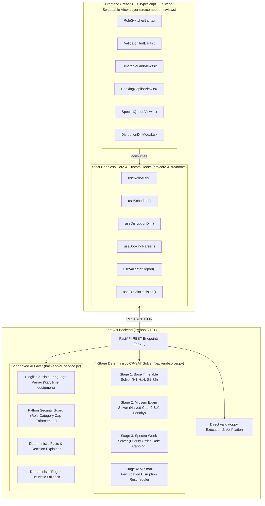

# Chilika Institute of Technology (CIT) Campus Scheduling & Venue Management ("Crunch Week")

[](validator.py)
[](validator.py)
[](validator.py)

A production-grade, full-stack campus scheduling platform engineered for the **Crunch Week** challenge at Chilika Institute of Technology (CIT). The system features a **4-stage deterministic CP-SAT solver** powered by **Google OR-Tools**, direct integration with `validator.py`, strict headless UI separation for future Hallmark styling, plain-language English & Hinglish booking parsing with guaranteed manual fallback, role-based workflows with **no self-approval**, and minimal-perturbation disruption rescheduling.

- **Live Deployed Application:** [https://cit-scheduling.vercel.app](https://cit-scheduling.vercel.app/)
- **Demo Video Walkthrough:** [https://youtu.be/cit-crunch-demo](https://youtu.be/cit-crunch-demo)

---

## Architecture Diagram



---

## Verified Official Validator Results

Both verified exports are generated and checked with `validator.py`:

### 1. Baseline Schedule (`exports/schedule.json`)
```bash
python validator.py --data cit_public.json --schedule exports/schedule.json
```
```text
Dataset: cit-public-v1   Schedule says: cit-public-v1   Team: CIT Crunch Team
Hard violations: 0  {}
Soft penalty: 150  {'S1': 0, 'S2': 147, 'S3': 0, 'S4': 3, 'S5': 0, 'S6': 0}
Bookings: score 67.0 | approved 22, alternatives 1, rejected 2, session overrides 0, priority inversions 0
Exam soft penalty: 0
```
- **0 Hard Violations**
- **0 Priority Inversions**
- **0 Exam Soft Penalty** (At most 1 exam per group per day across MON–SAT)
- **High Booking Score**: 67.0 / 70.0 (All eligible requests approved or offered valid alternatives)

### 2. After Disruption (`exports/schedule_after.json`)
```bash
python validator.py --data cit_public.json --schedule exports/schedule_after.json --disruption sample_disruption.json --baseline exports/schedule.json
```
```text
Dataset: cit-public-v1   Schedule says: cit-public-v1   Team: CIT Crunch Team
Hard violations: 0  {}
Soft penalty: 152  {'S1': 0, 'S2': 149, 'S3': 0, 'S4': 3, 'S5': 0, 'S6': 0}
Bookings: score 67.0 | approved 22, alternatives 1, rejected 2, session overrides 0, priority inversions 0
Exam soft penalty: 0
Stability: 11 sessions moved (1 changed time, 10 room only)
```
- **0 Hard Violations**
- **0 Priority Inversions**
- **Minimal Perturbation**: Accommodated all conference travel (`F07` on Mondays), complete closure of `CR-102`, and added session `CS202-T2` with **only 1 session changing time** and 10 sessions simply changing rooms!

---

## Tech Stack

| Layer | Technologies |
| --- | --- |
| **Backend** | Python 3.10+, FastAPI, Uvicorn, Google OR-Tools (`ortools.sat.python.cp_model`), Pydantic |
| **Frontend** | React 18, TypeScript, Tailwind CSS, Vite, Lucide Icons |
| **Solver** | 4-Stage CP-SAT (Integer & Boolean Constraint Programming) |
| **Validation** | Official `validator.py` (Imported directly into backend lifecycle) |
| **AI Layer** | Sandboxed NLP with Hinglish parsing, role category capping, and deterministic fallback |

---

## Demo Account Credentials & Permissions

Switch between all 4 accounts with one click in the top navigation bar or log in with the credentials below:

| Role | Email | Name & Department | Permissions & Workflow |
| --- | --- | --- | --- |
| **Admin** | `admin@cit.edu.in` | Prof. Shreya Kapoor (Dean's Office) | Solves timetable, applies disruptions, approves disruption diffs, uploads datasets, resets demo data, approves bookings |
| **Coordinator** | `coord.cse@cit.edu.in` | Dr. Rajesh Verma (Coordinator CSE) | Submits `department_event` requests, approves lab bookings (**no self-approval: `requester != approver`**) |
| **Faculty** | `f12@cit.edu.in` | Dr. Amit Behera (Faculty F12) | Inspects own timetable, requests session changes via CP-SAT clash checker, submits `guest_lecture` bookings |
| **Club Rep** | `dramatics@cit.edu.in` | Dramatics Society (Club) | Submits natural-language / Hinglish requests (capped at `club_event`), cancels own bookings, views decision explanations |

> [!IMPORTANT]
> **No Self-Approval Rule:** The backend strictly enforces `requester != approver`. If a Department Coordinator submits a booking request, they cannot approve their own booking; it must be approved by an independent coordinator or Admin.

---

## Local Setup & Quickstart

### Supabase schema
The Supabase database schema is in [`supabase/schema.sql`](./supabase/schema.sql). Run it once in the Supabase SQL Editor. It creates the relational tables for institutes, users, datasets, timetables, bookings, disruptions, and audit logs, enables row-level security, and retains original dataset/schedule JSON payloads for lossless import.

After applying it, create an institute row and associate user profiles and an active dataset with that institute. New Supabase Auth users receive a `faculty` profile by default; assign trusted roles such as `admin` from the Supabase dashboard. The schema is a database foundation only: this repository's FastAPI app still uses in-memory state and JSON files, so it must be connected to Supabase separately before the live website persists data there.

### Prerequisites
- Python 3.10+
- Node.js 18+ and npm

### 1. Backend Setup
```bash
# Install Python dependencies
pip install ortools fastapi uvicorn pydantic python-multipart httpx tzdata

# (Optional) Copy environment variables
cp .env.example .env

# Run solver to generate exports directly
python run_solvers.py

# Start FastAPI backend server
python -m uvicorn backend.main:app --host 127.0.0.1 --port 8000 --reload
```
The FastAPI backend will be available at `http://127.0.0.1:8000` (interactive OpenAPI documentation at `/docs`).

### 2. Frontend Setup
```bash
# In another terminal window:
cd frontend
npm install
npm run dev
```
Open `http://localhost:3000` in your browser. The Vite development server automatically proxies `/api` calls to the FastAPI backend.

---

## Supabase PostgreSQL Integration (Fast Setup)

1. **Create Tables & Schema**:
   - In your Supabase Dashboard, navigate to **SQL Editor** -> **New Query**.
   - Paste and run `supabase/schema.sql`.
2. **Configure Environment**:
   - Set `SUPABASE_URL` and `SUPABASE_SERVICE_ROLE_KEY` (or `SUPABASE_KEY`) in `.env`.
   - *(Optional when using publishable anon key)*: Paste and run `supabase/fix_permissions_for_backend.sql` in SQL Editor to grant schema permissions.
   - Click the **Sync Supabase** button in the header bar or call `POST /api/database/sync` to persist campus data.

---

## Deployment Guide

- **Frontend (Vercel)**:
  - Framework: **Vite** (Root Directory: `.` or `frontend`).
  - Pre-configured with `vercel.json` for automatic SPA routes and `/api` proxying.
  - Set Environment Variable: `VITE_API_BASE_URL` (pointing to your deployed backend URL).
- **Backend (Render / Railway / Cloud)**:
  - Build command: `pip install -r requirements.txt`
  - Start command: `uvicorn backend.main:app --host 0.0.0.0 --port $PORT`
  - Set Environment Variables: `SUPABASE_URL`, `SUPABASE_SERVICE_ROLE_KEY` (or `SUPABASE_KEY`), and optionally `LLM_API_KEY`.

---

## Key Features & Solvers

1. **Stage 1 (Base Timetable Solver):**
   - Formulates all 189 sessions, respect teaching periods 1..9, lunch break after P5, and lab start restrictions ({2, 6}).
   - Manages elective baskets (`OEB-1`, `OEB-2`, `OEB-3`) ensuring identical `(day, period)` across different rooms with zero group double-counting.
   - Places `ID101-ALL-L1` on `WED` in `AUD` to prevent conflicts with Spectra Week bookings `BR-01` (`MON` P4–P5) and `BR-20` (`FRI` P4–P5).

2. **Stage 2 (Midsem Exam Solver):**
   - Allocates 41 exams across 6 days (`MON`–`SAT`) and 2 sessions (`AM`, `PM`).
   - Applies integer halved capacity (`capacity // 2`).
   - Guarantees **0 Exam Soft Penalty** by enforcing at most 1 exam per student group per day.

3. **Stage 3 (Spectra Week Booking Solver):**
   - Strictly enforces role category caps (clubs asking for `institute_event` are capped to `club_event`).
   - Processes in order of category priority and submission timestamp to guarantee **0 priority inversions**.
   - Handles withdrawals (`cancellations`) with status `rejected`.
   - Offers valid alternatives across P1–P13 when requested windows are occupied.

4. **Stage 4 (Minimal-Perturbation Rescheduler):**
   - Mathematical stability objective:
     $$\text{Minimize}(10000 \times \text{time\_changed} + 5000 \times \text{room\_only\_changed} + \text{SoftPenalty})$$
   - Generates structured before/after diffs requiring Admin approval before overwriting the active schedule.

5. **Plain-Language & Hinglish AI Copilot:**
   - Interprets phrases like `"seminar hall kal shaam 6 baje, 2 ghante, 100 log, mic chahiye"`.
   - Resolves relative days (`"kal"` -> tomorrow's weekday), times (`"after lunch"` -> P6), and equipment needs.
   - Detects room-equipment mismatches (e.g., wheelchair request for `SH-2` triggers an alert recommending `SH-1`).
   - **Guaranteed Manual Fallback:** Full editable form provided; works seamlessly without an API key.

---

## Known Limitations
- The current implementation handles weekly recurring timetables and festival week overrides within the semester model defined by `cit_public.json`.
- Very large disruptions involving simultaneously closing more than 75% of campus capacity will trigger the infeasibility explainer to indicate exact bottleneck constraints.
